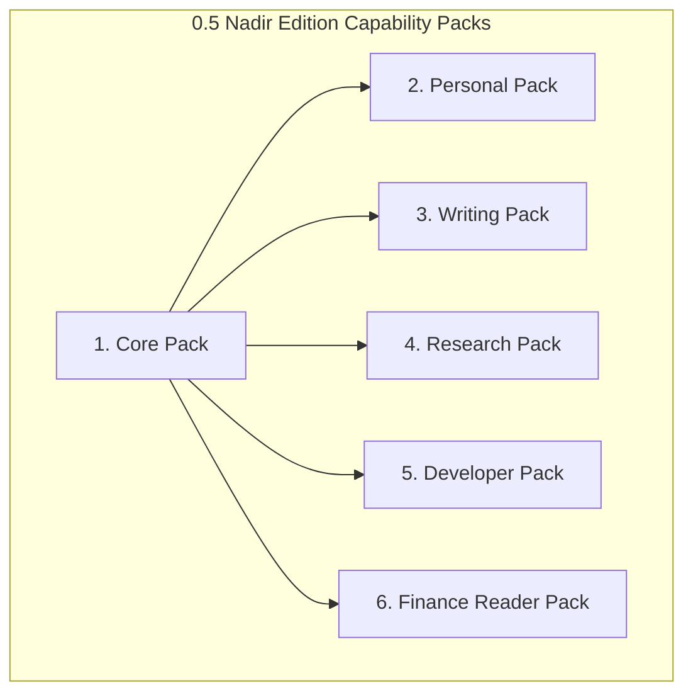

# Agent Engine — MVP Capability Packs Specification

> **Status:** Canonical Architecture Specification  
> **Audience:** Developers, Capability Authors, QA, CTO  
> **Target Release:** `0.5 Nadir Edition`  
> **Related Documents:** [`PRODUCT.md`](PRODUCT.md), [`DATA_MODEL.md`](DATA_MODEL.md), [`SECURITY.md`](SECURITY.md), [`RELEASE_GATES.md`](RELEASE_GATES.md)  
> **Task Reference:** `R0.2`

---

## 1. Overview & Pack Architecture

In Agent Engine 0.5 ("Nadir Edition"), capabilities are packaged as modular, versioned **Capability Packs**. Each pack bundles specialized skills, prompt templates, declarative workflows, and permission boundaries.

### Invariants for Capability Packs:
1. **Least Privilege:** Packs declare explicit permission scopes (`fs:read`, `fs:write`, `net:outbound`, `shell:exec`). Any action outside declared scopes is blocked at runtime.
2. **Approval Triggers:** Destructive or consequential actions defined in a pack unconditionally generate an `ApprovalRequest` via the Security Approval Service.
3. **Artifact-Oriented Output:** Workflows must produce durable, inspectable artifacts with cryptographic hashes and lineage records.
4. **Zero Out-of-Scope Execution:** Only the 6 MVP packs defined herein are active in Release 0.5.

---

## 2. The 6 MVP Capability Packs



---

### 2.1 Core Pack (`pack-core`)
The foundational execution and management layer required by all workflows and interactive sessions.

- **Category:** System / Core
- **Permissions Required:** `fs:read` (project root), `storage:sqlite`
- **Capabilities & Skills:**
  - `chat_session`: Multi-turn conversational interface with dynamic context assembly.
  - `project_manager`: Workspace indexing, file change observation (`watchdog`), and room mapping.
  - `model_router`: Real-time tier resolution (`LOCAL`, `MID`, `FRONTIER`) and failover.
  - `execution_manager`: Lifecycle management, cancellation token enforcement, and event streaming.
  - `approval_service`: Cryptographic authorization verification and replay protection.
- **Verification Mapping:** MVP-J1 (Project-aware conversation), MVP-J7 (Routing), MVP-J8 (Approval), MVP-J9 (Cancellation), MVP-J10 (Restart recovery), MVP-J12 (Truthful history).

---

### 2.2 Personal Pack (`pack-personal`)
Assists Nadir with daily task planning, private personal notes, and recurring operational reviews.

- **Category:** Personal Productivity
- **Permissions Required:** `fs:read` (user notes dir), `fs:write` (notes export), `cron:schedule`
- **Capabilities & Skills:**
  - `daily_planner`: Synthesizes open tasks, pending reviews, and calendar deadlines into daily priorities.
  - `note_indexer`: Semantic search and cross-referencing across markdown journals and daily logs.
  - `scheduled_reviewer`: Executes weekly project and task reviews via the Durable Job Runtime.
- **Pre-packaged Workflows:**
  - `weekly_project_brief.yaml`: Scans project activity over the past 7 days, summarizes changes, and stores a summary artifact.
- **Verification Mapping:** MVP-J11 (Scheduled automation surviving app restarts).

---

### 2.3 Writing Pack (`pack-writing`)
A rigorous editorial pipeline transforming rough notes and outlines into publication-ready documents.

- **Category:** Content & Publishing
- **Permissions Required:** `fs:read` (project root), `fs:write` (artifacts directory)
- **Workflow Pipeline:**
  1. **Outline Node:** Analyzes source notes and generates a structured document outline.
  2. **Drafting Node:** Expands outline sections into full prose using targeted prompts.
  3. **Style Review Node:** Evaluates tone, readability, clarity, and voice consistency.
  4. **Claim Review Node:** Highlights unsubstantiated claims and flags statements requiring source verification.
  5. **Artifact Assembly Node:** Compiles final document into a markdown artifact with metadata header.
- **Output:** Immutable Markdown artifact (`art_...`) linked to the originating session.
- **Verification Mapping:** MVP-J2 (Writing workflow producing a persistent, verified artifact).

---

### 2.4 Research Pack (`pack-research`)
Evidence-based research pipeline that rigorously separates verified source facts from synthesis and models' speculative extrapolations.

- **Category:** Research & Synthesis
- **Permissions Required:** `net:http` (curated web search & reading), `fs:read`, `fs:write` (artifacts)
- **Workflow Pipeline:**
  1. **Research Plan Node:** Breaks user inquiry into discrete verifiable hypothesis questions.
  2. **Source Collection Node:** Fetches external documentation, scientific papers, or web articles.
  3. **Evidence Extraction Node:** Extracts verbatim quotes, figures, and author claims with URLs/DOIs.
  4. **Synthesis Node:** Combines findings, explicitly highlighting areas of consensus vs. uncertainty.
  5. **Provenance Audit Node:** Validates that every synthesized assertion links back to an extracted source item.
- **Verification Mapping:** MVP-J3 (Deep research with explicit provenance and visible retrieval failures).

---

### 2.5 Developer Pack (`pack-developer`)
Autonomous software engineering assistant that operates safely within isolated Git worktrees.

- **Category:** Software Engineering
- **Permissions Required:** `fs:read`, `fs:write` (isolated worktree only), `git:worktree`, `shell:exec` (sandboxed test runners)
- **Workflow Pipeline:**
  1. **Diagnose & Specify:** Analyzes codebase, reproduces issue, and writes diagnostic spec.
  2. **Isolated Worktree Provision:** Creates an isolated Git worktree (`git worktree add ...`) ensuring the primary branch is completely untouched.
  3. **Implementation Node:** Applies minimal, surgical code modifications.
  4. **Test & Validation Node:** Executes local test runners (`pytest`, `cargo test`, `pnpm test`) inside the sandbox.
  5. **Independent Code Review Node:** A secondary model pass reviews the unified diff for regressions, security issues, and style violations.
  6. **Approval Gate:** Pauses execution with unified diff for user review (`waiting_approval`). Only user approval triggers merge/commit to primary branch.
- **Verification Mapping:** MVP-J4 (Coding workflow in isolated worktree with automated tests and review gate).

---

### 2.6 Finance Reader Pack (`pack-finance`)
Extracts, structures, and reconciles financial records with a strict, verifiable read-only guarantee.

- **Category:** Financial Analysis
- **Permissions Required:** `fs:read` (invoices, receipts, CSV exports), `fs:write` (reconciliation proposal artifacts)
- **Strict Invariant:** **Zero Money Movement.** This pack contains NO payment, wire transfer, transaction submission, or banking API write tools. Any attempt to invoke stateful financial mutations is rejected by the kernel.
- **Capabilities & Skills:**
  - `invoice_extractor`: Extracts vendor, invoice number, line items, taxes, and totals from PDF/image files.
  - `bank_csv_parser`: Normalizes dates, descriptions, amounts, and currencies across heterogeneous bank statements.
  - `reconciliation_matcher`: Correlates invoice records with bank transactions, computing confidence scores.
  - `uncertainty_flagger`: Explicitly flags ambiguous line items or unclassified transactions for user review.
- **Output:** Read-only reconciliation proposal table in markdown or JSON format.
- **Verification Mapping:** MVP-J6 (Finance reader with explicit confidence metrics and proposals only).

---

## 3. Pack Manifest Format (`manifest.yaml`)

Every capability pack adheres to the standardized manifest specification:

```yaml
schema_version: "1.0.0"
id: "pack-finance"
name: "Finance Reader Pack"
version: "0.5.0"
description: "Read-only document intelligence for invoices, receipts, and bank statement reconciliation."
category: "finance"
author: "TechnoVen"

permissions:
  - scope: "fs:read"
    paths: ["${PROJECT_ROOT}/documents/finance/**"]
  - scope: "fs:write"
    paths: ["${PROJECT_ROOT}/artifacts/**"]

skills:
  - id: "invoice_extractor"
    path: "skills/invoice_extractor.py"
  - id: "bank_csv_parser"
    path: "skills/bank_csv_parser.py"

workflows:
  - id: "reconcile_monthly_statements"
    path: "workflows/reconciliation.yaml"

evaluations:
  test_suite: "tests/packs/test_finance_reader.py"
  min_pass_rate: 1.0
```
