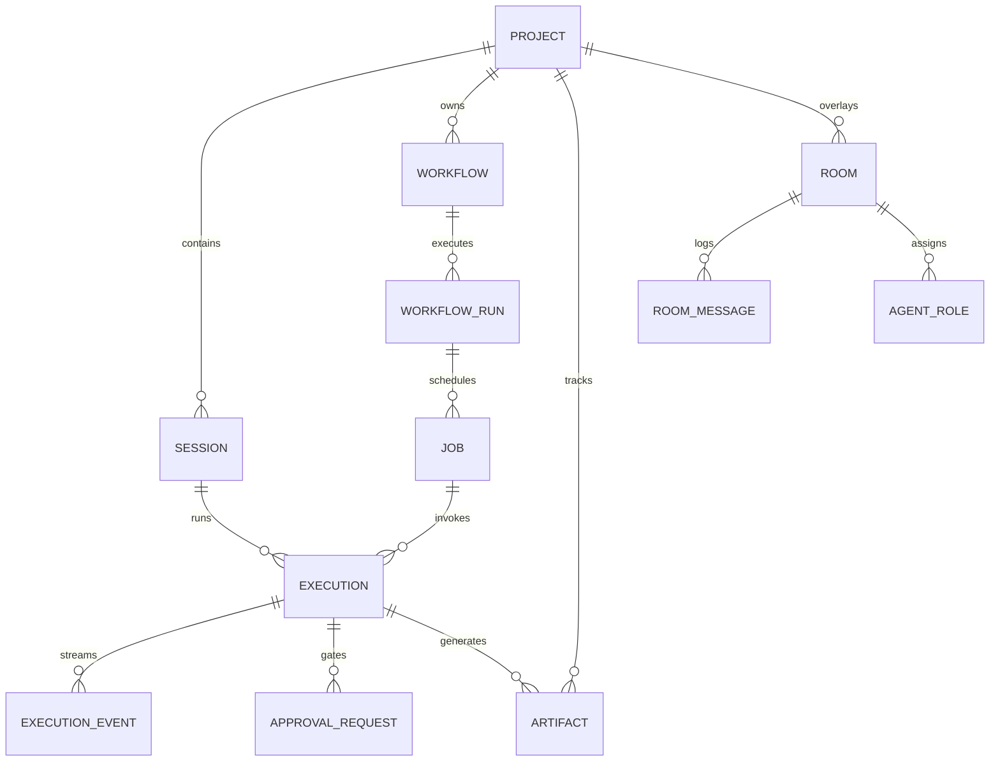

# Agent Engine — Canonical Data Model

> **Status:** Canonical Architecture Specification  
> **Audience:** Developers, Architects, AI Agents  
> **Related Documents:** [`ARCHITECTURE.md`](ARCHITECTURE.md), [`EXECUTION_MODEL.md`](EXECUTION_MODEL.md), [`SECURITY.md`](SECURITY.md), [`ROADMAP.md`](ROADMAP.md)  
> **Task Reference:** `R0.2`, `R0.4`

---

## 1. Architectural Invariants & Persistence Principles

1. **Local-First Repository Pattern:** All persistence is mediated through abstract repository interfaces (`core/storage/base.py`). In desktop single-user mode, `SQLiteBackend` (`core/storage/sqlite.py`) with WAL mode (`PRAGMA journal_mode=WAL`) is the canonical storage engine. In cloud/multi-tenant mode, `PostgresBackend` (`core/storage/postgres.py`) is used.
2. **Immutable Execution Audit:** Executions, execution events, and approval decisions are strictly append-only audit ledgers. Once recorded, execution records and events are never mutated or retroactively deleted.
3. **Decoupled Visual Layout:** Presentation and visual layout attributes (such as canvas `position: {x, y}`) are explicitly non-semantic layout metadata (`layout: {position: {x, y}}`). The core execution kernel never reads or requires canvas positions to execute a workflow or evaluate dependencies.
4. **Deterministic Identifier Scheme:** All system entities use prefixed, cryptographically unique or UUIDv4-based identifiers:
   - Project: `proj_<uuid>`
   - Session: `sess_<uuid>`
   - Execution: `exec_<uuid>`
   - Execution Event: `evt_<uuid>`
   - Job: `job_<uuid>`
   - Workflow: `wf_<uuid>`
   - Workflow Run: `wfrun_<uuid>`
   - Skill: `skill_<slug>@<version>`
   - Artifact: `art_<sha256_prefix>`
   - Approval Request: `appr_<uuid>`
5. **No Fabricated Data:** Telemetry fields (tokens, costs, latency) must either record true metrics reported by upstream providers/tools or be explicitly marked `is_estimated: true` / `UNKNOWN`.

---

## 2. Domain Vocabulary & Core Entities



### 2.1 Project (`core.projects.models.Project`)
The root organizational boundary for local user work, security contexts, knowledge bases, and collaborative rooms.
- **Owning Module:** `core/projects/`
- **Fields:**
  - `id: str` — Canonical identifier (`proj_...`)
  - `name: str` — Human-readable project name
  - `description: Optional[str]` — Short project synopsis
  - `root_path: Path` — Local absolute path to the project root directory
  - `settings: ProjectSettings` — Model routing defaults, budget ceilings, tool permissions
  - `created_at: datetime` — UTC timestamp
  - `updated_at: datetime` — UTC timestamp

### 2.2 Session (`core.sessions.models.Session`)
A stateful, multi-turn interaction thread within a project. Preserves conversation context, active agent assignments, and message history.
- **Owning Module:** `core/sessions/`
- **Fields:**
  - `id: str` — Canonical identifier (`sess_...`)
  - `project_id: str` — Foreign key to `Project.id`
  - `title: str` — Thread title (auto-generated or user-assigned)
  - `model_override: Optional[str]` — Session-scoped model target override
  - `created_at: datetime` — UTC timestamp
  - `updated_at: datetime` — UTC timestamp
  - `metadata: Dict[str, Any]` — Arbitrary UI or session state

### 2.3 Execution (`core.execution.models.Execution`)
The atomic or composite unit of coordinated work orchestrated by `ExecutionCoordinator`. Governed by the strict lifecycle state machine defined in [`EXECUTION_MODEL.md`](EXECUTION_MODEL.md).
- **Owning Module:** `core/execution/`
- **Fields:**
  - `id: str` — Canonical identifier (`exec_...`)
  - `session_id: Optional[str]` — Foreign key to `Session.id` (null for headless/scheduled jobs)
  - `project_id: str` — Foreign key to `Project.id`
  - `request: ExecutionRequest` — The complete immutable invocation specification
  - `status: ExecutionStatus` — Lifecycle status (`CREATED` through `COMPLETED` / `FAILED` / `CANCELLED`)
  - `provider: Optional[str]` — Resolved model provider (`ollama`, `gemini`, `anthropic`, `openai`)
  - `model: Optional[str]` — Resolved concrete model name
  - `routing_tier: Optional[RoutingTier]` — Selected routing tier (`LOCAL`, `MID`, `FRONTIER`)
  - `input_tokens: Optional[int]` — Total prompt tokens consumed
  - `output_tokens: Optional[int]` — Total completion tokens generated
  - `total_cost_usd: Optional[float]` — Calculated total cost in USD
  - `is_cost_estimated: bool` — True if provider did not return exact usage
  - `started_at: Optional[datetime]` — Timestamp when execution entered `RUNNING`
  - `completed_at: Optional[datetime]` — Timestamp when execution entered terminal state
  - `error_message: Optional[str]` — Error description if status in `FAILED`, `BLOCKED`, `TIMED_OUT`
  - `error_code: Optional[str]` — Structured error identifier

### 2.4 ExecutionEvent (`core.execution.models.ExecutionEvent`)
An append-only real-time event record emitted during an execution, streamed to the desktop UI via SSE and persisted to the audit log.
- **Owning Module:** `core/execution/`
- **Fields:**
  - `id: str` — Canonical identifier (`evt_...`)
  - `execution_id: str` — Foreign key to `Execution.id`
  - `sequence_num: int` — Strictly monotonic 0-based counter per execution
  - `timestamp: datetime` — High-resolution UTC timestamp
  - `event_type: ExecutionEventType` — Enum (`STATE_CHANGE`, `TOKEN_DELTA`, `TOOL_CALL_STARTED`, `TOOL_CALL_COMPLETED`, `APPROVAL_REQUIRED`, `ERROR`)
  - `payload: Dict[str, Any]` — Type-specific structured event payload

### 2.5 Job (`core.jobs.models.Job`)
A durable, recoverable background work item managed by the Durable Job Runtime. Supports retry policies, exponential backoff, priority queueing, and cancellation.
- **Owning Module:** `core/jobs/`
- **Fields:**
  - `id: str` — Canonical identifier (`job_...`)
  - `project_id: str` — Foreign key to `Project.id`
  - `workflow_run_id: Optional[str]` — Foreign key to `WorkflowRun.id` if part of a workflow
  - `idempotency_key: str` — Unique key preventing duplicate scheduling
  - `task_name: str` — Function or handler name to execute
  - `payload: Dict[str, Any]` — Input parameters for the task
  - `status: JobStatus` — `QUEUED`, `RUNNING`, `PAUSED`, `SUCCEEDED`, `FAILED`, `CANCELLED`
  - `priority: int` — Priority score (0=default, higher runs first)
  - `retry_count: int` — Current number of retries attempted
  - `max_retries: int` — Maximum allowed retries before permanent failure
  - `backoff_seconds: float` — Initial exponential backoff base
  - `scheduled_at: datetime` — Earliest timestamp when job is eligible to run
  - `locked_by: Optional[str]` — Worker process identifier holding the job lock
  - `lock_expires_at: Optional[datetime]` — Lock lease expiration timestamp

### 2.6 Workflow (`core.workflows.models.WorkflowDefinition`)
A declarative Directed Acyclic Graph (DAG) describing multi-step tasks, agent interactions, tool calls, and branching logic.
- **Owning Module:** `core/workflows/`
- **Fields:**
  - `id: str` — Canonical identifier (`wf_...`)
  - `project_id: str` — Foreign key to `Project.id`
  - `name: str` — Human-readable workflow name
  - `version: int` — Integer version number incremented on modification
  - `nodes: List[WorkflowNode]` — Array of node definitions
  - `edges: List[WorkflowEdge]` — Array of directed edges with dependency semantics
  - `metadata: Dict[str, Any]` — Non-semantic metadata (tags, author, descriptions)
  - `layout: Dict[str, Any]` — **Decoupled visual layout metadata** (e.g., node canvas coordinates `{node_id: {x: float, y: float}}`)
  - `created_at: datetime` — UTC timestamp
  - `updated_at: datetime` — UTC timestamp

#### Decoupled Layout Invariant & Legacy Compatibility
```json
{
  "id": "node_extract_text",
  "type": "tool",
  "config": {
    "tool_name": "pdf_extractor",
    "params": {"format": "markdown"}
  },
  "layout": {
    "position": {"x": 240.0, "y": 180.0},
    "color": "blue"
  }
}
```
*Backward-Compatibility Rule:* If a legacy workflow definition containing top-level `position: {"x": ..., "y": ...}` is loaded from SQLite or YAML, the parser normalizes it on ingestion into `layout.position` while preserving execution semantics.

### 2.7 WorkflowRun (`core.workflows.models.WorkflowRun`)
The durable execution instance of a Workflow.
- **Owning Module:** `core/workflows/`
- **Fields:**
  - `id: str` — Canonical identifier (`wfrun_...`)
  - `workflow_id: str` — Foreign key to `WorkflowDefinition.id`
  - `workflow_version: int` — Version of definition executed
  - `status: WorkflowRunStatus` — `RUNNING`, `PAUSED_FOR_APPROVAL`, `COMPLETED`, `FAILED`, `CANCELLED`
  - `node_states: Dict[str, NodeExecutionState]` — Per-node state map (`PENDING`, `RUNNING`, `COMPLETED`, `FAILED`, `SKIPPED`)
  - `node_outputs: Dict[str, Any]` — Output data dictionary keyed by `node_id`
  - `total_cost_usd: float` — Aggregate execution cost across all executed nodes
  - `started_at: datetime` — UTC timestamp
  - `completed_at: Optional[datetime]` — UTC timestamp

### 2.8 Skill (`core.skills.models.SkillManifest`)
A versioned, self-contained capability pack or tool provider complying with the Skills 2.0 specification.
- **Owning Module:** `core/skills/`
- **Fields:**
  - `id: str` — Canonical identifier (`skill_<slug>@<version>`)
  - `name: str` — Human-readable display name
  - `version: str` — SemVer string (`1.0.0`)
  - `description: str` — Detailed capability summary for prompt routing
  - `permissions: List[PermissionScope]` — Required permissions (e.g., `fs:read`, `net:outbound`)
  - `tools: List[ToolDefinition]` — Function schemas and descriptions
  - `prompts: Dict[str, str]` — Reusable prompt templates
  - `manifest_path: Path` — Path to `SKILL.yaml`
  - `is_builtin: bool` — True if packaged in core distribution

### 2.9 Artifact (`core.artifacts.models.Artifact`)
An immutable document, file, code diff, or structured report produced by an execution.
- **Owning Module:** `core/artifacts/`
- **Fields:**
  - `id: str` — Canonical identifier (`art_...`)
  - `project_id: str` — Foreign key to `Project.id`
  - `execution_id: str` — Foreign key to `Execution.id`
  - `name: str` — File or artifact name (`market_research_report.md`)
  - `mime_type: str` — MIME type (`text/markdown`, `application/json`, `text/x-patch`)
  - `file_path: Path` — Relative storage path within project artifact directory
  - `sha256_hash: str` — Cryptographic digest of file contents
  - `size_bytes: int` — Byte length of content
  - `lineage: Dict[str, Any]` — Provenance metadata (sources, model, tool chain)
  - `created_at: datetime` — UTC timestamp

### 2.10 ApprovalRequest (`core.security.models.ApprovalRequest`)
A security authorization gate generated whenever an execution proposes a consequential or destructive action.
- **Owning Module:** `core/security/`
- **Fields:**
  - `id: str` — Canonical identifier (`appr_...`)
  - `execution_id: str` — Foreign key to `Execution.id`
  - `action_type: str` — Action identifier (e.g., `bash:execute`, `fs:write`, `git:commit`)
  - `resource_target: str` — Affected target (file path, URL, command line)
  - `argument_hash: str` — SHA-256 digest of canonicalized argument dictionary
  - `risk_level: RiskLevel` — `LOW`, `MEDIUM`, `HIGH`, `CRITICAL`
  - `status: ApprovalStatus` — `PENDING`, `APPROVED`, `REJECTED`, `EXPIRED`
  - `created_at: datetime` — UTC timestamp
  - `expires_at: datetime` — UTC expiration timestamp (default: +15 minutes)
  - `resolved_at: Optional[datetime]` — UTC resolution timestamp
  - `decision_by: Optional[str]` — User identity or profile that resolved the gate

---

## 3. SQLite Relational Schema (DDL)

```sql
-- Core Schema: SQLite 3.38+ with Foreign Key and WAL support

PRAGMA foreign_keys = ON;

-- 1. Projects Table
CREATE TABLE IF NOT EXISTS projects (
    id TEXT PRIMARY KEY,
    name TEXT NOT NULL,
    description TEXT,
    root_path TEXT NOT NULL UNIQUE,
    settings_json TEXT NOT NULL DEFAULT '{}',
    created_at TEXT NOT NULL,
    updated_at TEXT NOT NULL
);

-- 2. Sessions Table
CREATE TABLE IF NOT EXISTS sessions (
    id TEXT PRIMARY KEY,
    project_id TEXT NOT NULL REFERENCES projects(id) ON DELETE CASCADE,
    title TEXT NOT NULL,
    model_override TEXT,
    metadata_json TEXT NOT NULL DEFAULT '{}',
    created_at TEXT NOT NULL,
    updated_at TEXT NOT NULL
);
CREATE INDEX IF NOT EXISTS idx_sessions_project ON sessions(project_id);

-- 3. Executions Ledger
CREATE TABLE IF NOT EXISTS executions (
    id TEXT PRIMARY KEY,
    session_id TEXT REFERENCES sessions(id) ON DELETE SET NULL,
    project_id TEXT NOT NULL REFERENCES projects(id) ON DELETE CASCADE,
    status TEXT NOT NULL,
    request_json TEXT NOT NULL,
    provider TEXT,
    model TEXT,
    routing_tier TEXT,
    input_tokens INTEGER DEFAULT 0,
    output_tokens INTEGER DEFAULT 0,
    total_cost_usd REAL DEFAULT 0.0,
    is_cost_estimated INTEGER NOT NULL DEFAULT 0,
    started_at TEXT,
    completed_at TEXT,
    error_code TEXT,
    error_message TEXT,
    created_at TEXT NOT NULL
);
CREATE INDEX IF NOT EXISTS idx_executions_project ON executions(project_id);
CREATE INDEX IF NOT EXISTS idx_executions_session ON executions(session_id);
CREATE INDEX IF NOT EXISTS idx_executions_status ON executions(status);

-- 4. Execution Events Stream
CREATE TABLE IF NOT EXISTS execution_events (
    id TEXT PRIMARY KEY,
    execution_id TEXT NOT NULL REFERENCES executions(id) ON DELETE CASCADE,
    sequence_num INTEGER NOT NULL,
    timestamp TEXT NOT NULL,
    event_type TEXT NOT NULL,
    payload_json TEXT NOT NULL,
    UNIQUE(execution_id, sequence_num)
);
CREATE INDEX IF NOT EXISTS idx_events_execution ON execution_events(execution_id);

-- 5. Durable Jobs
CREATE TABLE IF NOT EXISTS jobs (
    id TEXT PRIMARY KEY,
    project_id TEXT NOT NULL REFERENCES projects(id) ON DELETE CASCADE,
    workflow_run_id TEXT,
    idempotency_key TEXT NOT NULL UNIQUE,
    task_name TEXT NOT NULL,
    payload_json TEXT NOT NULL,
    status TEXT NOT NULL,
    priority INTEGER NOT NULL DEFAULT 0,
    retry_count INTEGER NOT NULL DEFAULT 0,
    max_retries INTEGER NOT NULL DEFAULT 3,
    backoff_seconds REAL NOT NULL DEFAULT 2.0,
    scheduled_at TEXT NOT NULL,
    locked_by TEXT,
    lock_expires_at TEXT,
    created_at TEXT NOT NULL,
    updated_at TEXT NOT NULL
);
CREATE INDEX IF NOT EXISTS idx_jobs_status_scheduled ON jobs(status, scheduled_at);

-- 6. Workflow Definitions
CREATE TABLE IF NOT EXISTS workflows (
    id TEXT PRIMARY KEY,
    project_id TEXT NOT NULL REFERENCES projects(id) ON DELETE CASCADE,
    name TEXT NOT NULL,
    version INTEGER NOT NULL DEFAULT 1,
    definition_yaml TEXT NOT NULL,
    layout_json TEXT NOT NULL DEFAULT '{}',
    created_at TEXT NOT NULL,
    updated_at TEXT NOT NULL,
    UNIQUE(project_id, name, version)
);

-- 7. Workflow Runs
CREATE TABLE IF NOT EXISTS workflow_runs (
    id TEXT PRIMARY KEY,
    workflow_id TEXT NOT NULL REFERENCES workflows(id) ON DELETE CASCADE,
    workflow_version INTEGER NOT NULL,
    status TEXT NOT NULL,
    node_states_json TEXT NOT NULL DEFAULT '{}',
    node_outputs_json TEXT NOT NULL DEFAULT '{}',
    total_cost_usd REAL DEFAULT 0.0,
    started_at TEXT NOT NULL,
    completed_at TEXT
);
CREATE INDEX IF NOT EXISTS idx_workflow_runs_workflow ON workflow_runs(workflow_id);

-- 8. Artifacts Ledger
CREATE TABLE IF NOT EXISTS artifacts (
    id TEXT PRIMARY KEY,
    project_id TEXT NOT NULL REFERENCES projects(id) ON DELETE CASCADE,
    execution_id TEXT NOT NULL REFERENCES executions(id) ON DELETE CASCADE,
    name TEXT NOT NULL,
    mime_type TEXT NOT NULL,
    file_path TEXT NOT NULL,
    sha256_hash TEXT NOT NULL,
    size_bytes INTEGER NOT NULL,
    lineage_json TEXT NOT NULL DEFAULT '{}',
    created_at TEXT NOT NULL
);
CREATE INDEX IF NOT EXISTS idx_artifacts_project ON artifacts(project_id);
CREATE INDEX IF NOT EXISTS idx_artifacts_execution ON artifacts(execution_id);

-- 9. Security Approval Requests
CREATE TABLE IF NOT EXISTS approval_requests (
    id TEXT PRIMARY KEY,
    execution_id TEXT NOT NULL REFERENCES executions(id) ON DELETE CASCADE,
    action_type TEXT NOT NULL,
    resource_target TEXT NOT NULL,
    argument_hash TEXT NOT NULL,
    risk_level TEXT NOT NULL,
    status TEXT NOT NULL,
    created_at TEXT NOT NULL,
    expires_at TEXT NOT NULL,
    resolved_at TEXT,
    decision_by TEXT
);
CREATE INDEX IF NOT EXISTS idx_approvals_execution ON approval_requests(execution_id);
CREATE INDEX IF NOT EXISTS idx_approvals_status ON approval_requests(status);
```

---

## 4. Migration & Schema Evolution Strategy

1. **Alembic Versioning:** All schema updates are captured in linear Alembic migration scripts located in `alembic/versions/`.
2. **Offline Local Migrations:** The desktop shell automatically executes pending migrations upon startup using `core/storage/migrations.py`.
3. **Rollback Guarantee:** Every migration file must implement both `upgrade()` and `downgrade()` methods. Irreversible migrations are forbidden.
4. **Data Preservation on Migration:** Column removals or table renames must follow a dual-write deprecation window before final deletion.
