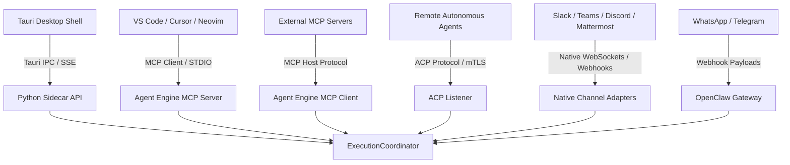

# Agent Engine — Protocol Boundaries & Integration Architecture

> **Status:** Canonical Architecture Specification  
> **Audience:** Developers, Integrators, Security Auditors  
> **Related Documents:** [`ARCHITECTURE.md`](ARCHITECTURE.md), [`SECURITY.md`](SECURITY.md), [`DATA_MODEL.md`](DATA_MODEL.md)  
> **Task Reference:** `R0.2`

---

## 1. Architectural Integration Principles

1. **Protocol-First Interoperability:** External agents, tools, messaging channels, and desktop interfaces communicate with Agent Engine through standardized, versioned protocols rather than proprietary ad-hoc shims.
2. **Strict Invariant Enforcement:** All inbound requests from any protocol—whether an MCP tool call, an ACP peer command, a Slack message, or a Tauri IPC call—must converge on the canonical `ExecutionCoordinator`. No integration may bypass security policy, budget evaluation, approval gates, or execution logging.
3. **Native Team Channel Independence (ADR-013):** Team communication channels (Slack, Microsoft Teams, Discord, Mattermost) are implemented strictly using native, in-tree Python adapters. Agent Engine has zero dependency on Switch or any commercial source-available bridges.
4. **Isolated Personal Messaging:** Personal messaging channels (Telegram, WhatsApp) are mediated via the OpenClaw gateway adapter, preserving local desktop privacy and preventing unvetted webhook exposure.

---

## 2. Integration Protocol Matrix

---

## 3. Detailed Protocol Specifications

### 3.1 Model Context Protocol (MCP)

Agent Engine supports dual-mode MCP operation as both a Client and a Server:

#### MCP Client Architecture (`core.mcp.client`)
- Connects to external third-party MCP servers via `stdio` or Server-Sent Events (SSE).
- Dynamically discovers tools, prompts, and resources.
- Converts discovered tools into canonical `ToolDefinition` schemas registered in the `ExecutionCoordinator` tool registry.
- Enforces argument validation, timeouts, and security approval gates on tool invocations.

#### MCP Server Architecture (`services.python.mcp_server`)
- Exposes Agent Engine capabilities to external IDEs, development environments, and other agent hosts via FastMCP.
- Key exposed tools:
  - `query_project_memory`: Semantic and lexical search over indexed project knowledge.
  - `analyze_and_patch_code`: Generate structured unified diffs with test verification.
  - `get_system_telemetry`: Inspection of active executions, budgets, and system health.
- Enforces bearer token authentication on all external connections.

### 3.2 Agent Communication Protocol (ACP)

The Agent Communication Protocol enables peer-to-peer collaboration between autonomous agents:
- **Location:** `core/acp/`
- **Transport:** WebSocket or HTTP/2 over mutual TLS (mTLS).
- **Framing:** JSON-RPC 2.0 framing with mandatory signature validation.
- **Message Types:**
  - `Handshake`: Capability and identity negotiation.
  - `TaskOffer`: Proposition of work from a delegating agent.
  - `TaskAccept` / `TaskReject`: Acceptance or rejection based on local capacity.
  - `StreamChunk`: Incremental streaming of partial outputs.
  - `TaskComplete`: Final result with verifiable cryptographic artifact hash.
- **Feature Flag Governance:** Governed by `ENABLE_ACP` in `core/config/flags.py`. Defaults to `false` in single-user desktop mode; enabled only when distributed agent collaboration is explicitly configured.

### 3.3 Native Team Channel Adapters (ADR-013)

Per ADR-013, all enterprise chat channels are implemented directly in-tree to guarantee 100% license freedom (Apache-2.0 / MIT) and eliminate third-party runtime dependencies:

| Channel | Adapter Module | Protocol Mechanics | Inbound Handling | Outbound Formatting |
|---|---|---|---|---|
| **Slack** | `core/adapters/slack.py` | WebSocket Socket Mode (w/ automatic reconnect) & Events API | Normalizes mentions (`<@U...>`), unwraps event envelopes, enforces signature verification | Slack Block Kit components with action buttons |
| **Microsoft Teams** | `core/adapters/teams.py` | Bot Framework Activity HTTP / Webhooks | Strips `<at>...</at>` tags, sanitizes HTML, validates Bot Framework JWTs | Adaptive Cards v1.4 with markdown fallback |
| **Discord** | `core/adapters/discord.py` | Discord Gateway WebSocket v10 (Heartbeat OP 1, Identify OP 2) | Normalizes `<@!...>` mentions, handles ping interactions, dispatches messages | Rich Embeds with role mentions and interactive components |
| **Mattermost** | `core/adapters/mattermost.py` | Native Mattermost WebSocket protocol & REST API | Strips `@...` mentions, tracks thread `root_id`, handles auth challenge | Markdown posts with interactive custom props |

*Execution Guarantee:* Inbound messages from channels are mapped into `ExecutionRequest` instances assigned to the corresponding project or collaborative room. All responses stream back to the originating channel thread.

### 3.4 Personal Omnichannel Gateway (OpenClaw)

- **Module:** `core/adapters/omnichannel.py`
- **Purpose:** Connect personal messaging platforms (Telegram and WhatsApp) without exposing local desktop ports to the public internet.
- **Architecture:** Communicates with an external or local OpenClaw gateway via signed webhook payloads.
- **Privacy Boundary:** Messages received via OpenClaw are mapped strictly to the user's personal project workspace and undergo credential and secret redaction before being processed.

### 3.5 Desktop Shell & Tauri IPC Integration

- **Frontend:** React 18 + TypeScript + Vite (`apps/desktop/`)
- **Host Shell:** Tauri v2 in Rust (`apps/desktop/src-tauri/`)
- **Sidecar API:** Python FastAPI process (`services/python/`)
- **IPC Mechanics:**
  - The React UI invokes Tauri Rust commands (`invoke('execute_prompt', { ... })`).
  - Rust supervises the Python sidecar process lifecycle, health checks (`GET /v1/health`), and port binding.
  - Streaming updates flow from Python to React via Server-Sent Events (SSE) or local WebSocket connections on `http://127.0.0.1:<allocated_port>/v1/events`.
  - Process isolation ensures that an unexpected Python sidecar crash does not crash the desktop window, and the Tauri supervisor automatically orchestrates sidecar restart.
